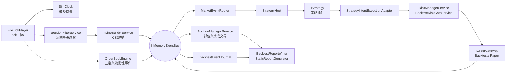
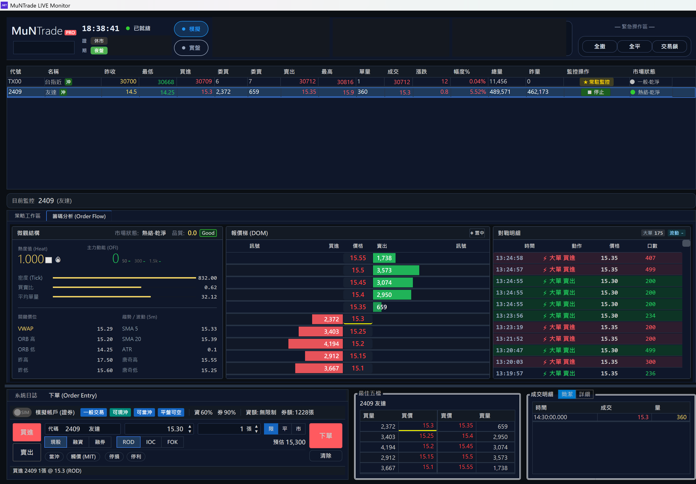
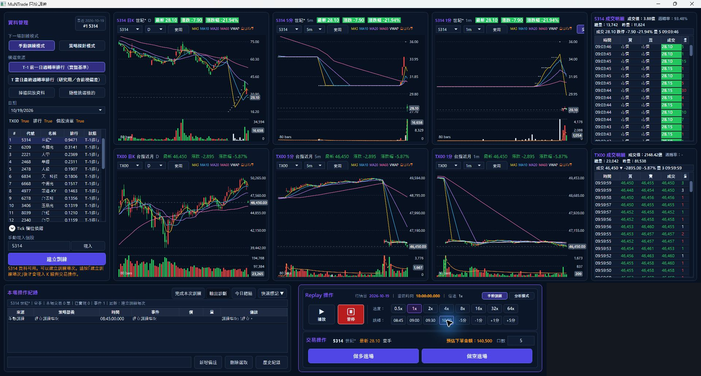

# MuNTrade｜事件驅動交易系統 (Event-driven trading system)

[](https://github.com/MurrayLu/trading-system/actions/workflows/ci.yml)
[](https://codespaces.new/MurrayLu/trading-system)

**C# / .NET 8 的即時行情與交易執行系統。** 同一套事件匯流排、行情管線、策略執行框架、委託閘道與帳務，同時服務實盤、Paper 與回測；換的只有行情來源、時鐘與閘道實作。

這個 repository 是我私人交易系統的三個核心專案（約 470 個原始檔），加上一個跨平台的命令列入口，讓你不需要券商帳號、不需要 Windows，就能把整條流程實際跑一遍。

## 30 秒看結果 (See it in 30 seconds)

**[→ 線上回測報表 Live backtest report](https://MurrayLu.github.io/trading-system/)**

報表由 CI 在每次 push 時重新執行回測後產生：5 檔商品、5 個交易日、102,000 筆 tick，經過完整的行情管線、策略、風控、撮合與帳務，輸出累計損益曲線、商品與日期的損益表，以及每一筆完成交易的明細。

> 行情是固定 seed 的合成資料，策略是驗證流程用的均線交叉範例。報表展示的是系統，不是績效。

## 快速開始 (Quick start)

**Codespaces（免安裝）**：點上方徽章開啟後執行

```bash
./demo.sh
```

**本機**：需要 [.NET 8 SDK](https://dotnet.microsoft.com/download/dotnet/8.0)

```bash
./demo.sh        # macOS / Linux
./demo.ps1       # Windows PowerShell
```

**Docker**

```bash
docker build -t muntrade-demo . && docker run --rm muntrade-demo
```

`demo` 腳本會依序執行回測與報表產生，結果寫到 `out/` 與 `site/index.html`。也可以直接使用 CLI：

```bash
dotnet run --project src/MuNTrade.Demo.Cli -c Release -- list-strategies
dotnet run --project src/MuNTrade.Demo.Cli -c Release -- backtest --symbol 9901 --from 2024-03-11 --to 2024-03-12
dotnet run --project src/MuNTrade.Demo.Cli -c Release -- report
```

`backtest` 可用 `--symbol`、`--from`、`--to`、`--strategy`、`--out` 覆寫 [appsettings.demo.json](src/MuNTrade.Demo.Cli/appsettings.demo.json) 的預設值；所有設定也能用 `MUNTRADE_` 前綴的環境變數覆寫。

## 架構 (Architecture)



虛線表示公開樣本沒有走到的路徑：樣本只有成交 tick、沒有五檔報價，所以 OrderBook 在 demo 回測中不會被驅動，它的行為由單元測試涵蓋。

| 層 | 責任 | 位置 |
| --- | --- | --- |
| 契約 | 事件、領域型別、券商／資料來源／時鐘／閘道的介面 | [src/MuNTrade.Abstractions](src/MuNTrade.Abstractions/) |
| 核心 | 行情處理、OrderBook、策略執行框架、風控、委託、帳務、回測主機 | [src/MuNTrade.Core](src/MuNTrade.Core/) |
| 基礎設施 | 檔案行情來源、歷史資料讀取、交易日曆、儲存 | [src/MuNTrade.Infrastructure](src/MuNTrade.Infrastructure/) |
| 展示入口 | 只做 DI 組裝、參數解析與報表，不含交易邏輯 | [src/MuNTrade.Demo.Cli](src/MuNTrade.Demo.Cli/) |

一筆 tick 從讀檔到成交回報的完整時序、DI 註冊內容，以及如何掛上自己的策略與資料，見 [docs/ARCHITECTURE.md](docs/ARCHITECTURE.md)。

## 工程重點 (Engineering highlights)

**一套核心，三種執行模式。** 券商、行情來源、時鐘與委託閘道都在 [MuNTrade.Abstractions](src/MuNTrade.Abstractions/) 以介面定義，核心不認識任何具體實作。[CoreServicesRegistration](src/MuNTrade.Core/Extensions/CoreServicesRegistration.cs) 依 `AppMode` 組出不同的服務圖：回測用 `SimClock` 與 [BacktestOrderGateway](src/MuNTrade.Core/Backtesting/BacktestOrderGateway.cs)，Paper 用 [PaperTradingGateway](src/MuNTrade.Core/Trading/Gateways/PaperTradingGateway.cs)，其餘管線相同。公開版 CLI 的組裝本身（[DemoCli.cs](src/MuNTrade.Demo.Cli/DemoCli.cs)）不到兩百行，就是因為這個切法。

**策略是插件。** 策略實作 [IStrategy](src/MuNTrade.Abstractions/Contracts/Strategy/IStrategy.cs)，由範本建立實例；透過 [IStrategyIngressSpec](src/MuNTrade.Abstractions/Contracts/Strategy/IStrategyIngressSpec.cs) 宣告自己需要哪些商品、週期與指標，由 [StrategyRuntime](src/MuNTrade.Core/StrategyRuntime/) 負責訂閱、路由與生命週期。策略只送出意圖，風控與下單由框架處理。repo 內附六個驗證用策略範本，可用 `list-strategies` 查看。

**OrderBook 的品質分級與可追溯的抑制。** [OrderBookEngine](src/MuNTrade.Core/OrderBook/OrderBookEngine.cs) 先評估五檔資料本身的品質等級，品質不足時停止產生衍生訊號。[LiquidityFlowDetector](src/MuNTrade.Core/OrderBook/LiquidityFlowDetector.cs) 偵測大單掛出與撤單時，被規則擋下的事件不是直接丟掉，而是照常發出並標記 `IsSuppressed` 與原因，事後可以分析每一條規則擋掉了什麼。

**可回放的回測。** [BacktestHost](src/MuNTrade.Core/Backtesting/BacktestHost.cs) 逐日逐商品建立獨立的執行範圍，[FileTickPlayer](src/MuNTrade.Infrastructure/DataAccess/FileSystem/FileTickPlayer.cs) 依序供應 tick，時鐘跟著行情時間前進。回測支援單日虧損、連續虧損、每日交易次數與進場時間窗等風控設定，並計入手續費與交易稅。每次執行都留下事件日誌，報表由日誌產生。

**可重現是被測試的性質。** 樣本資料由 [固定 seed 的產生器](tools/MuNTrade.SampleData/Program.cs) 產生；CI 會重新產生一次並與 repo 內的樣本逐檔比對內容，再連跑兩次回測比對摘要雜湊。報表產生器對相同輸入輸出逐位元相同的 HTML。

## 程式碼導覽 (Code map)

| 路徑 | 檔案數 | 內容 |
| --- | ---: | --- |
| [src/MuNTrade.Abstractions](src/MuNTrade.Abstractions/) | 約 270 | 介面、事件、領域模型、DTO |
| [src/MuNTrade.Core](src/MuNTrade.Core/) | 約 170 | 行情管線、OrderBook、策略執行框架、交易與風控、回測 |
| [src/MuNTrade.Infrastructure](src/MuNTrade.Infrastructure/) | 約 30 | 檔案行情來源、資料存取、服務註冊 |
| [src/MuNTrade.Demo.Cli](src/MuNTrade.Demo.Cli/) | 8 | 命令列入口、DI 組裝、靜態報表 |
| [tools/MuNTrade.SampleData](tools/MuNTrade.SampleData/) | 2 | 合成 tick 與 K 線產生器 |
| [tests](tests/) | 6 | OrderBook 與流動性偵測單元測試、CLI 端對端測試 |
| [samples](samples/) | 62 | 合成樣本資料與 [格式說明](samples/README.md) |

建議的閱讀順序：[IStrategy](src/MuNTrade.Abstractions/Contracts/Strategy/IStrategy.cs) → [MaCrossProbeStrategy](src/MuNTrade.Core/Strategies/Verification/MaCrossProbeStrategy.cs) → [BacktestHost](src/MuNTrade.Core/Backtesting/BacktestHost.cs) → [OrderBookEngine](src/MuNTrade.Core/OrderBook/OrderBookEngine.cs)。

## 私人版與公開版 (Private vs public)

三個核心專案是從私人 repository（commit `4517d44`）**以整個專案為單位**搬出來的，不是為了展示另外寫的精簡版。差異只有下表這幾項。

| | 私人版 | 公開版 |
| --- | --- | --- |
| 核心程式 | Abstractions、Core、Infrastructure | 同一份原始碼，移除下列未公開的部分 |
| 策略 | 實際使用的策略 | 驗證用範例策略 |
| 行情來源 | 券商即時行情 | 合成 tick 檔，格式與私人版的歷史 tick 檔相同 |
| 券商連線 | 有 | 無，只有 Paper 與回測閘道 |
| 自適應行情處理 | 有 | 未公開；OrderBook 因此使用設定檔的固定基準門檻 |
| 操作介面 | WPF 桌面應用程式 | 命令列與靜態 HTML 報表 |

## 原始系統畫面 (Original application)

私人版 WPF 介面的歷史截圖，帳戶、資金與持倉區已遮蔽。這些畫面不在此 repository 中執行。





## 測試與 CI (Tests & CI)

```bash
dotnet test MuNTrade.sln -c Release
```

- [MuNTrade.Core.Tests](tests/MuNTrade.Core.Tests/)：OrderBook 的掛單、撤單、補單、成交消耗與價格位移；流動性偵測的各條抑制規則。
- [MuNTrade.Demo.Tests](tests/MuNTrade.Demo.Tests/)：樣本產生的決定性、單檔回測有成交且輸出完整、缺資料時的錯誤處理、報表自足且可重現。
- [CI](.github/workflows/ci.yml)：在 Ubuntu 與 Windows 建置並測試；驗證樣本與回測可重現；產生報表並部署到 GitHub Pages。

## 已知限制 (Known limitations)

- **事件路由的順序。** [MarketEventRouter](src/MuNTrade.Core/StrategyRuntime/Routing/MarketEventRouter.cs) 以非同步方式派送事件，策略診斷事件的順序在不同次執行間可能不同。樣本資料上的成交、完成交易與損益可重現，但這是回測決定性的弱點；改進方向是每個商品一條有序佇列，並在推進時鐘前明確等待排空。
- **回測日誌不含委託事件。** 目前記錄策略封包、成交、完成交易與策略狀態。
- **撮合模型簡化。** 以 tick 價格整筆成交，不模擬交易所佇列位置、延遲與部分成交。
- **公開版不能下單。** 沒有券商連線。
- **測試涵蓋有限。** 單元測試集中在 OrderBook；帳務、風控與 K 線建構目前靠端對端回測間接涵蓋。
- **Dockerfile 尚未納入 CI。**

## 我的角色與 AI 協作 (Role & AI collaboration)

我主導需求、系統方向、模組規劃與驗收；Codex 與 Claude 等 AI 參與架構細節與大量實作。公開版的匯出、未公開元件的移除，以及展示用的組裝層，是 AI 在我訂的規格與驗收下完成的。

## 授權 (License)

公開供技術閱讀，未另行授予開源授權。
